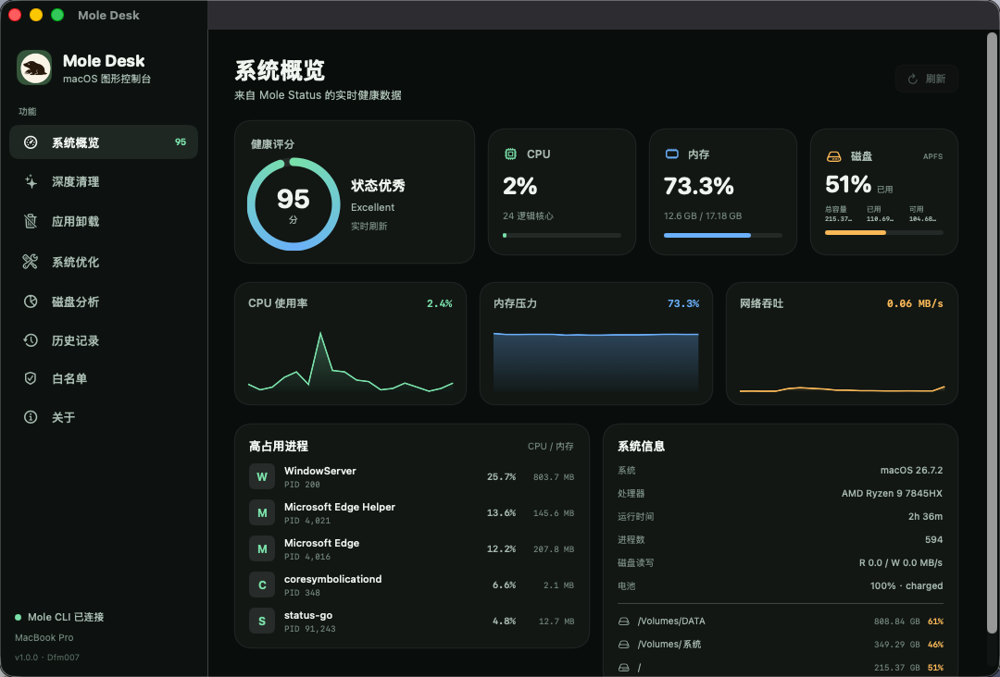
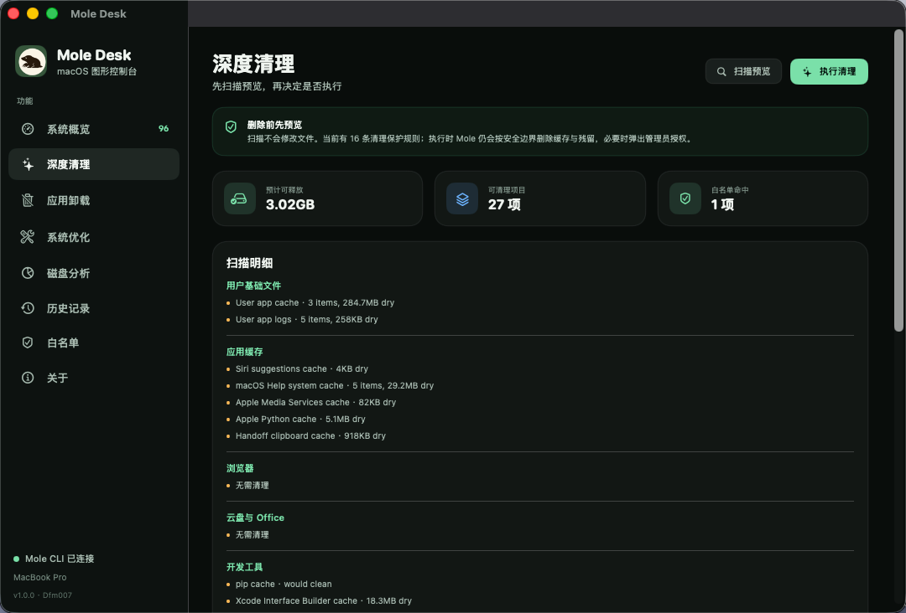
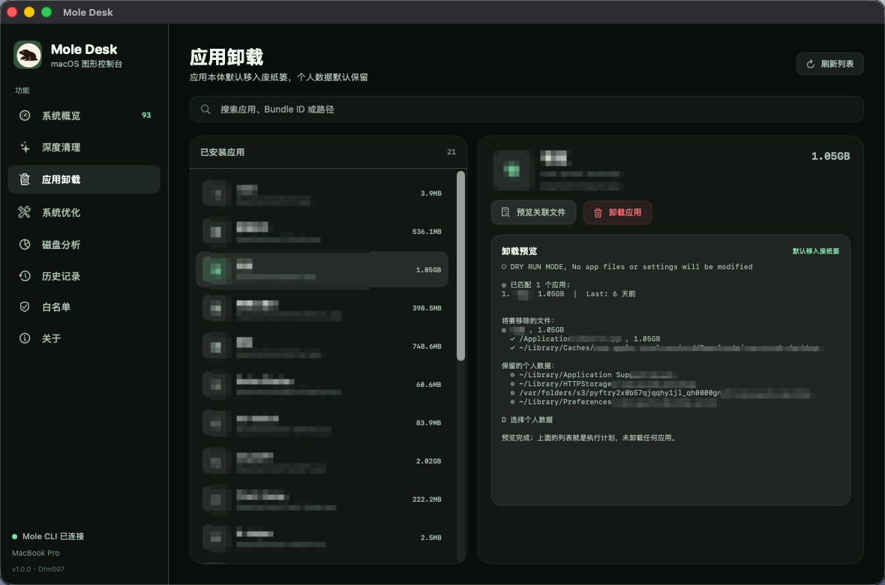
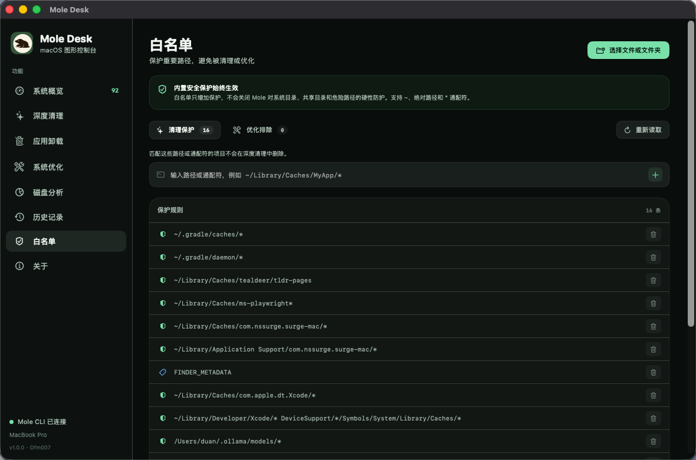

# Mole Desk

Mole 的 macOS 图形界面外壳。Mole 源码和运行文件已经内置在 `Vendor/Mole`，构建时会自动打包进 App。

- 开发者：Dfm007
- 版本：1.0.1
- GitHub：<https://github.com/Dfm007/Mole-Desk>

## 界面预览

### 系统概览



### 深度清理



### 应用卸载



### 白名单



## 功能

- 系统概览：CPU、内存、磁盘、网络、电池、高占用进程
- 深度清理：扫描预览、确认后执行
- 应用卸载：扫描应用、预览关联文件、确认后卸载
- 系统优化：预览后执行，需要时弹出 macOS 管理员授权
- 磁盘分析：选择目录并逐层查看占用
- 历史记录：读取 Mole 操作日志
- 白名单：管理清理白名单和优化白名单

## 目录

- `Sources/MoleDesk.swift`：完整 GUI 源码，单文件 SwiftUI
- `Vendor/Mole/`：内置的 Mole 源码与运行文件
- `Resources/`：图标、Info.plist 和系统兼容 shim
- `build.sh`：编译 GUI，并把 `Vendor/Mole` 的运行时复制进 App
- `Mole Desk.app`：构建产物

## 构建

进入项目根目录后执行：

```bash
./build.sh
```

构建脚本会自动识别当前项目目录，不依赖固定绝对路径。构建只读取 `Vendor/Mole`，不依赖外部 Mole 仓库。App 包内的 Mole 运行时位于：

`Mole Desk.app/Contents/Resources/Mole/`

打包后 `Mole Desk.app` 可以单独拷贝到其他 Intel Mac 使用。运行时产生的配置、白名单和日志仍保存在当前用户的 `~/.config/mole` 与 `~/Library/Logs/mole`。

当前构建为 x86_64，最低系统为 macOS 15+，同一个 DMG 可运行在 macOS 15 和 macOS 26 上。内置 `status-go` 的最低系统版本也是 15.0。Apple Silicon 机器需要 Rosetta 2，或另行构建 arm64 版本。

## 更新 Mole

将新的 Mole 源码同步到 `Vendor/Mole/`，检查差异后重新运行 `./build.sh`。不要直接修改 `Mole Desk.app/Contents/Resources/Mole/`，重新构建会覆盖它。
